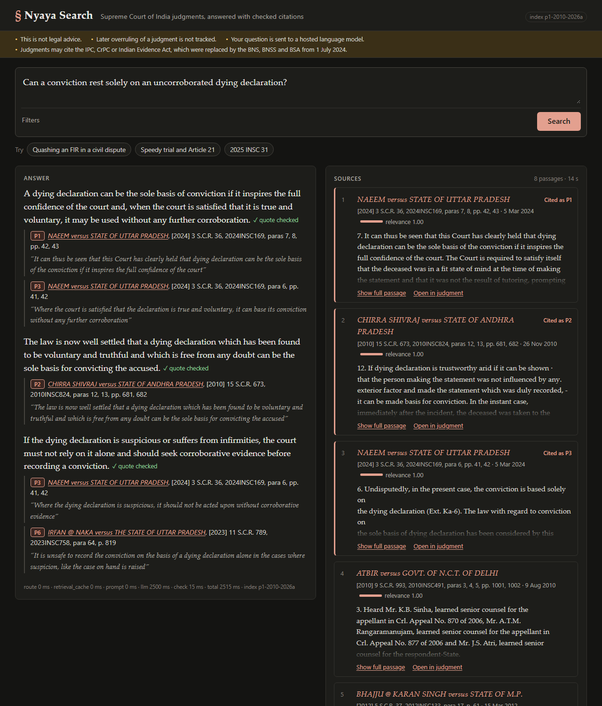
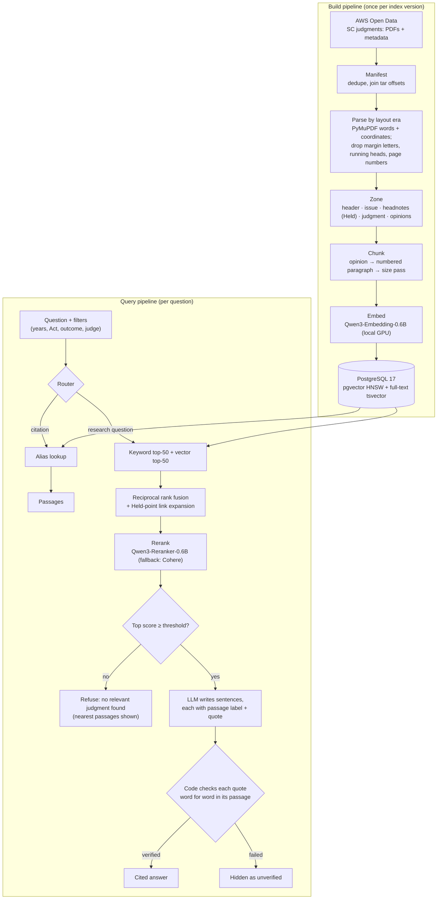

# Nyaya Search

**Cited legal research over Indian Supreme Court judgments, where code, not the model, checks every quote.**

Nyaya Search answers a lawyer's research question from the 2010–2026 judgments of the Supreme Court of India. Each sentence of an answer cites a retrieved passage and quotes it word for word, and a citation check written in code confirms that each quote really is in that passage before the sentence is shown. A sentence that fails the check is hidden, and its case name and citation are never shown. When the evidence is too weak, the system refuses ("no relevant judgment found") instead of guessing. It runs on one PC with a 6 GB GPU, using free tools: PostgreSQL with pgvector, local Qwen3 embedding and reranking models, and a free hosted LLM.

<!-- Screenshot or GIF of the page: save it as docs/img/nyaya-search.png and uncomment the next line.

-->

## What a lawyer sees

1. **The passages first.** On submit, the page calls `POST /search` and lists the ranked source passages at once, with case name, SCR citation, paragraph, page, date and relevance score.
2. **Then a checked answer.** `POST /ask` writes the answer. Every sentence carries one or more citation chips (`P1`, `P2`, …), each with its case, paragraph, page and exact quote. Clicking a chip scrolls to that passage in the sources and highlights the quoted words.
3. **Or an honest "no".** If no passage clears the refusal threshold, the page says *No relevant judgment found* and marks the nearest passages *Does not answer the question*. Sentences that failed the check sit behind a collapsed *Show N unverified sentences*, without any citation details.

A citation such as `2025 INSC 31` or `[2025] 1 SCR 230` skips search and the LLM: the router resolves it and returns the judgment's issue and headnote passages.

## How it works



**Build** (`nyaya-build`): a manifest of all 38,397 distinct judgments; then the 2010–2026 slice (13,007 judgments, roughly 250,000 chunks) is parsed, zoned, chunked, linked, embedded and loaded into a new, versioned index, which is checked before it can be activated.

**Query** (`nyaya-api`): the router sends citations to an alias lookup and everything else to hybrid search. Keyword and vector results are fused with reciprocal rank fusion (k = 60), expanded through headnote-to-paragraph links, reranked, and gated by a refusal threshold. Only then does the LLM write, and only the sentences that pass the citation check are shown. Every `/ask` writes a trace row: route, filters, versions, retrieved chunks with their scores, the refusal decision, the citations removed and the time per stage.

## Key engineering decisions

**Citation lock: labels plus exact quotes, checked by code.** The LLM sees passages labelled `P1` to `P8` and must return JSON sentences that each cite a label and copy an 8–40-word quote from it. Code normalises both texts and checks that the quote occurs in the cited passage. The citation a reader sees (case, SCR citation, paragraph, page) is then built by code from the passage's metadata, never written by the model. Sentences that fail go to an `unverified` list that never carries citation details, and statements that the passages do not cover a point go to `gaps`. Free-form answers checked afterwards, and labels without quotes, were both considered and rejected (design, Alternatives C and D).

**Structure-aware chunking.** Judgments are cut along their own structure: opinion (majority, concurring, dissenting), then numbered paragraph, then a size pass that splits long paragraphs and merges short ones (target 400 words, range 80–700). Chunk boundaries fall between paragraphs, so a citation names the paragraph a lawyer will look up. Each chunk carries a metadata header (case, year, zone) that is embedded and keyword-indexed but never quoted. Fixed token windows, semantic chunking, LLM-written chunk context and per-document chunker selection were considered and rejected; recursive splitting is kept only as the fallback inside one over-long paragraph (design, Alternatives G–L).

**Layout eras.** The Supreme Court Reports PDFs come in distinct layouts. Era C (2010–2023) prints margin letters A–H beside the text, among the words a text extractor returns. Era D (late 2023 onward) is born digital, with labelled *Issue for Consideration* and *Headnotes* sections. Each PDF is classified from its first pages, and the parser removes margin letters, running heads and page numbers by their position on the page, using bands calibrated on a seeded 50-PDF sample. Docling for every era was tested and rejected for v1 (design, Alternative F). Era B (the scanned 1964–2009 volumes) has its own parser, which finds the body column on each page and removes the margin letters outside it ([findings](docs/era_b_findings.md)); those years are not in the index yet.

**Refusal threshold.** After reranking, the top score must clear a threshold, or the system refuses before calling the LLM. The thresholds are tuned per reranker (the local Qwen reranker and the Cohere fallback score differently), on the development set only, under the rule that at most 10% of answerable questions may be refused. They are stored with the index version, not in code.

**Hybrid search in one database.** PostgreSQL holds the judgments, chunks, vectors (pgvector HNSW, with iterative scans so filtered queries still return enough rows), the full-text index, citation aliases and traces. Filters apply to keyword and vector search alike, over one copy of the data. Qdrant is the planned scale-out path, and an OpenSearch comparison is planned (design, Alternatives M and N).

**Search before the answer.** `POST /search` runs exactly the retrieval that `/ask` uses and stops before the LLM, so the passages appear as soon as reranking finishes. The `/ask` that follows reuses that retrieval from a small cache (same question, filters and index version) instead of searching again.

## Data

The corpus is the AWS Open Data dataset **[Indian Supreme Court Judgments](https://registry.opendata.aws/indian-supreme-court-judgments/)** (`s3://indian-supreme-court-judgments`), licensed **CC BY 4.0** by its publishers. It holds the judgments as PDFs from the Supreme Court Reports, with metadata in Parquet. The data is not in this repository; about 23 GB of English PDFs and metadata download with the script below.

## Quickstart

Requirements: Python 3.12 with [uv](https://docs.astral.sh/uv/), Docker, and an NVIDIA GPU for the build (the author uses an RTX 2060 with 6 GB). The API can also run on the CPU in Docker (see below).

```bash
# 1. Install
uv sync --extra dev --extra eval
cp .env.example .env            # then fill in the LLM key; DATABASE_URL works as is

# 2. Database (PostgreSQL 17 + pgvector), then the migrations
docker compose up -d db
uv run python -m nyaya.store.db

# 3. Data (about 23 GB)
uv run python scripts/download_sc.py --dest docs --skip-regional

# 4. Build an index for one year (or --years 2010-2026) and activate it
uv run nyaya-build run --years 2025 --version v2025a

# 5. Serve the API and the page on http://127.0.0.1:8000
uv run nyaya-api
```

`nyaya-build run` performs the stages in order, and each can also run alone. Every stage writes under `build/` (git-ignored) and skips finished work, so an interrupted build resumes with the same command:

```bash
uv run nyaya-build manifest                     # build/manifest.parquet
uv run nyaya-build calibrate                    # build/bands.json (Era C bands)
uv run nyaya-build parse-chunk --years 2025     # exits 3 if a G6 chunk metric fails
uv run nyaya-build embed --years 2025           # GPU
uv run nyaya-build load --version v2025a        # checks IDs, G6 and the smoke questions
uv run nyaya-build activate --version v2025a
```

Set `HF_HUB_OFFLINE=1` once the models are in the Hugging Face cache.

### Running the API in Docker (CPU)

The `api` compose profile builds a CPU image (no model weights baked in; they download into a volume on the first start) and runs it next to the database. The index must already be built and active.

```bash
docker compose --profile api up -d --build      # http://127.0.0.1:8000
```

On the CPU, answers are several times slower than on a GPU; the latency target (G7) is measured on the GPU.

### API

| Endpoint | What it does |
| --- | --- |
| `POST /search` | `{"question", "filters"?}` → the ranked passages, with their text and rerank scores. No LLM, no trace. |
| `POST /ask` | Same body → a checked answer, passages only, a refusal, or `no_match_with_filters`. Traced. |
| `GET /judgment/{path}?highlight={chunk_id}` | The judgment record with the passage's character span; in a browser, the judgment text with the passage highlighted. |
| `GET /health` | Active index version, models loaded, fallback configured, standing notices. |

Filters: `year_from`, `year_to`, `act` (normalised, so "IPC" and "Indian Penal Code, 1860" match), `outcome` (`allowed`, `dismissed`, `disposed`, `directions`, `referred`, `other`) and `judge`. The response contracts are in [`contracts/schema.json`](contracts/schema.json), generated from `src/nyaya/contracts.py`. The server binds 127.0.0.1, and each request has a 30-second limit.

## Evaluation

Every goal is measured with `nyaya-eval` against frozen question sets ([`eval/datasets/`](eval/datasets/README.md)): a development set drafted from headnote points for the author's hand check, 40 deliberately unanswerable questions and 20 adversarial ones. A separate final test set is used only for reporting. Each run is saved under `eval/runs/` and in the `eval_runs` table.

| Gate | Target | Command | Result |
| --- | --- | --- | --- |
| G1 Every shown citation is checked | No citation details on any unverified sentence; rule-break rate recorded | `answers` | results pending |
| G2 Supported claims | ≥ 90% of verified sentences rated *supported* by a judge from another model family (judge κ ≥ 0.6 against hand labels) | `judge-validate`, `answers` | results pending |
| G3 Search finds the right judgment | Right judgment in the top 50 before reranking for ≥ 90% of questions, and in the top 5 after reranking for ≥ 75% | `retrieval` | results pending |
| G4 Search holds as the index grows | From about 10,000 chunks to the full slice, both G3 numbers drop by ≤ 5 points (95% paired-bootstrap upper bound) | `size-steps` | results pending |
| G5 Refusal rate | ≥ 80% of unanswerable questions refused; ≤ 10% of answerable ones | `tune-threshold`, `answers` | results pending |
| G6 Clean parsing and chunking | ≥ 98% paragraph integrity, ≥ 99% size compliance, no chunk over the model limit; no margin letters or running heads in a 50-PDF hand check | `nyaya-build parse-chunk`, `g6-holdout` | results pending |
| G7 Answers within 15 s | 95th percentile, end to end, warm, one request at a time | `latency` | results pending |
| G8 Every answer can be explained | A trace per request; every wrong answer labelled hallucination, retrieval error or reasoning error | `answers` | results pending |
| G9 Safe on hostile input | No unchecked citation details; advice-seeking and false-premise questions refused or given the standing notice | `answers` | results pending |
| G10 Reproducible | One command rebuilds the index from the dataset snapshot of 2026-11-11 | `nyaya-build run` | results pending |

```bash
uv run nyaya-eval build-devset        # draft the development set from headnote points
uv run nyaya-eval g6-holdout          # 50 held-out PDFs, page images beside clean text, for the G6 hand check
uv run nyaya-eval retrieval           # G3, per method (keyword, exact and HNSW vector, hybrid, hybrid + rerank)
uv run nyaya-eval size-steps          # G4
uv run nyaya-eval bm25-trigger        # Postgres full-text search against bm25s
uv run nyaya-eval tune-threshold      # G5 thresholds, per reranker
uv run nyaya-eval judge-validate      # the judge's agreement with hand labels
uv run nyaya-eval answers             # G1, G2, G5, G8, G9 (resumable across days of free quota)
uv run nyaya-eval latency             # G7
uv run nyaya-eval lawyer-export       # a sample of answers for review by a practising lawyer
uv run nyaya-eval lawyer-import
uv run --extra ragas nyaya-eval ragas  # RAGAS metrics over the latest answers run (never a gate)
```

### RAGAS, beside our own checks

`nyaya-eval ragas` scores the development questions of a finished `answers` run with four [RAGAS](https://docs.ragas.io/) metrics: faithfulness, answer relevancy, context precision (with reference) and context recall. The reference is each question's Held text, from the dev set's hand-check CSV. The LLM is the free Groq judge model (`JUDGE_*`), paced by the same rate limiter as the G2 judge, and answer relevancy uses a small sentence-transformers model on the CPU (`[ragas]` in `config/settings.toml`). It needs the optional `ragas` extra (`uv sync --extra eval --extra ragas`), which CI does not install. Scores are saved per question and the run resumes where it stopped, like `answers`. The report goes to `eval/runs/ragas-<answers run>.json`, and the markdown table beside it (`.md`) puts our metrics and the RAGAS ones side by side.

Refused questions have no answer to judge. They are counted, with the refusal rate, and left out of faithfulness and answer relevancy, as are questions that ended with no verified sentence. Context precision and recall depend only on retrieval, so they cover every question with a reference.

RAGAS faithfulness and our quote check answer different questions. RAGAS faithfulness asks an LLM to split the answer into claims and judge each against the retrieved passages, so it is an estimate that can vary with the model and the prompt. Our quote check is exact: code verifies that every shown quote is a normalised substring of the passage it cites, and a sentence that fails loses its citation. The quote check (with the G2 judge on top) stays the primary metric. RAGAS is a secondary, comparable number, and never a gate.

The unit tests (`uv run pytest`) cover every response path of the pipeline and the API with fakes, the citation check against a fixture of citation cases, the parser on synthetic PDFs (and on sample PDFs when the data is present), and the evaluation statistics. CI runs ruff, the format check and pytest on every push.

## Tech stack

| Layer | Choice |
| --- | --- |
| Language and tooling | Python 3.12, uv, ruff, pytest, GitHub Actions |
| PDF parsing | PyMuPDF (word coordinates), position-based removal of page furniture per layout era |
| Storage and search | PostgreSQL 17, pgvector (HNSW, iterative scan), Postgres full-text search, Docker Compose |
| Embedding | Qwen3-Embedding-0.6B, 1024 dimensions, local GPU (sentence-transformers, PyTorch) |
| Reranking | Qwen3-Reranker-0.6B on the local GPU; fallback Cohere Rerank 5 Fast through OpenRouter (the only paid call, logged) |
| Answer LLM | A free hosted model through an OpenAI-compatible API (currently `openai/gpt-oss-120b` on Groq) |
| Judge LLM | A different model family (currently Qwen on Groq) |
| API and page | FastAPI and Uvicorn; plain HTML, CSS and JavaScript, with no build step |
| Contracts | Pydantic models, exported to JSON Schema |

## Roadmap

From the design's Future Improvements:

- **Older judgments:** an Era B (1964–2009) build (the parser is done), Era A with OCR, and a fuzzy quote route for OCR text.
- **A High Court subset**, chosen by court and year.
- **Scale-out to Qdrant** past 1–2 million vectors, or when filtered search misses its latency budget.
- **Answers:** stream, then replace with the checked version; one query rewrite before a refusal; failover between LLM providers.
- **Index checks:** probe questions that check the refusal threshold on every new index version; a vector cache keyed by content hash.
- **Citation data:** links from cited cases to their judgments, with their treatment ("relied on", "referred to"); tables extracted as single chunks.
- **Research:** rhetorical-role labels; evidence for each side of a contested question.
- **A Rust product layer**, once the `/ask` contract has been stable for one evaluation cycle.

Done from that list: a `/search` endpoint, so passages show before the written answer.

## Repository layout

```text
src/nyaya/          the package: corpus, parse, zone, chunk, link, models, store, search, answer, api, eval
web/                the page (index.html, app.js, style.css)
config/             settings.toml (every tunable value), act_aliases.toml
prompts/            the answer and judge prompts
contracts/          schema.json, generated from src/nyaya/contracts.py
db/                 Postgres init and migrations
eval/               datasets and the lawyer-review rubric (runs are git-ignored)
docs/designs/       the system design: goals, architecture, alternatives, as-built notes
docs/reviews/       design review reports
scripts/            download, data checks, layout and parser studies
tests/              pytest suites, fixtures and fakes
```

The design document, [`docs/designs/nyaya_search.md`](docs/designs/nyaya_search.md), records every goal, each alternative considered and why it was chosen or rejected, and how each part was built.

## Licence

Code and documentation: Apache-2.0 (see [LICENSE](LICENSE)). Judgment data: CC BY 4.0, from the AWS Open Data *Indian Supreme Court Judgments* dataset. Nyaya Search is a research tool, not legal advice, and it does not track whether a judgment was later overruled.
